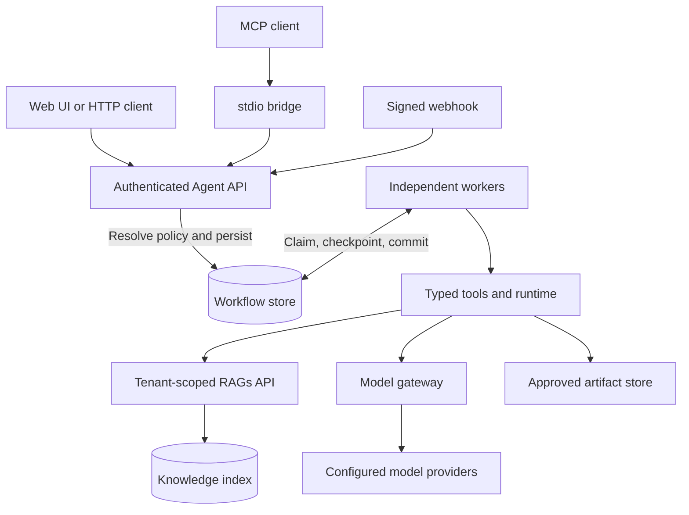
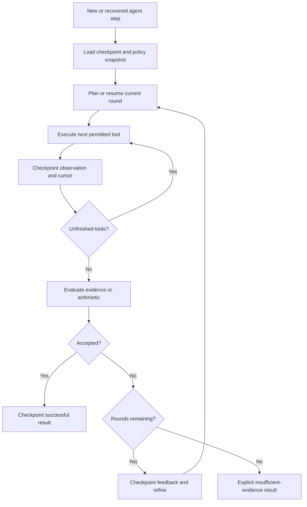
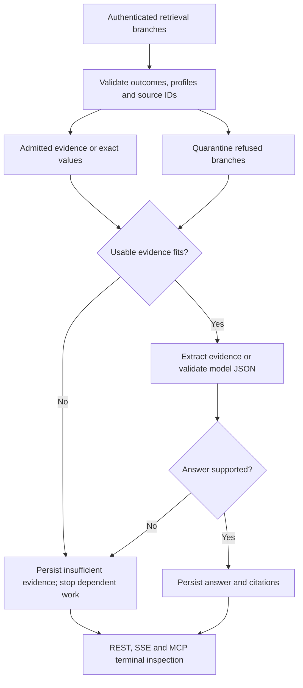
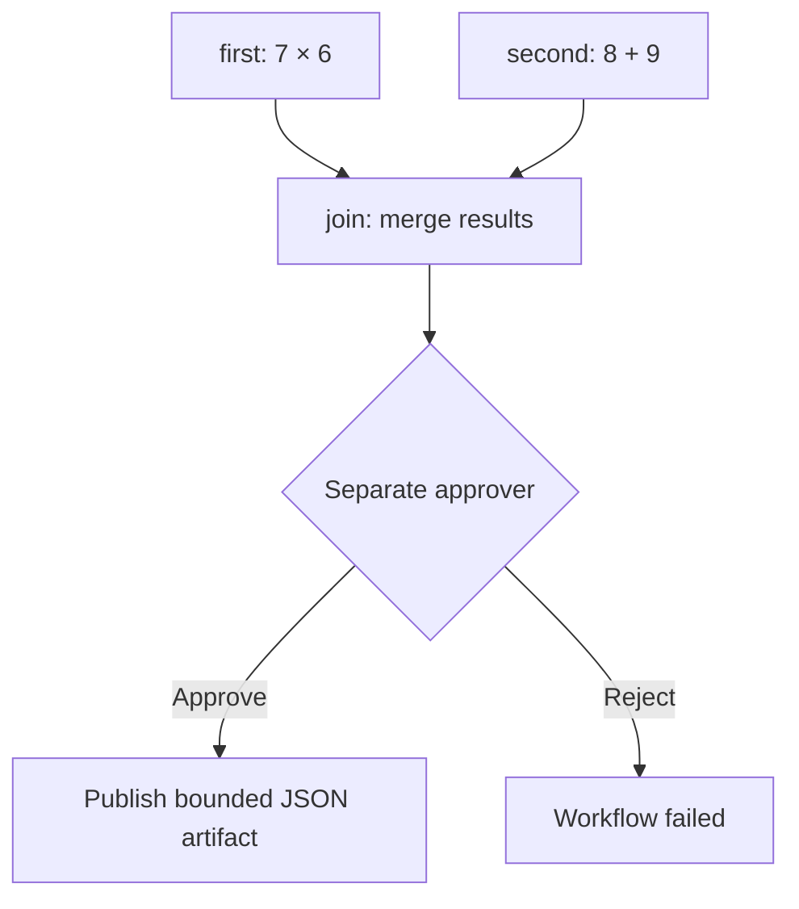
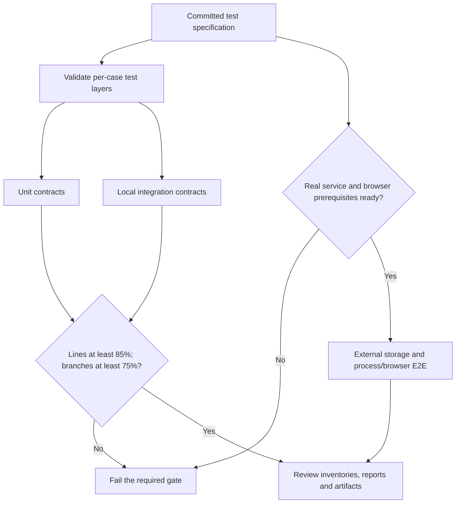

# Agentic System

[](https://github.com/MasterLKH180cm/agentic-system/actions/workflows/ci.yml)

**Run durable workflows and bounded agents, inspect their evidence, and approve effects with a separate identity.**

Agentic System is a Python 3.11+ / FastAPI runtime for validated DAGs and
checkpointed **plan → execute → evaluate → replan** loops. Independent workers
execute typed tools; the companion [RAGs](https://github.com/MasterLKH180cm/RAGs)
service owns document ingestion and retrieval. The local stack works without
paid model credentials.

Version 0.5 adds bounded PostgreSQL pooling, tenant/run locks, safe mixed-version
`SKIP LOCKED` scheduling and an explicit Inkling 2 Mini profile; see the
[v0.5 specification](docs/SPEC_V05.md). Version 0.4 adds operator feature controls and a PostgreSQL/pgvector deployment; see the [v0.4 specification](docs/SPEC_V04.md). Version 0.3 preserves evidence refusals across retrieval, synthesis, loops,
durable results, SSE and MCP, and snapshots the required RAG admission policy.
It builds on v0.2's immutable definitions, policy snapshots, memory, renewable
leases, model budgets, a small web UI, authenticated event streams, and optional
identity, persistence, and telemetry adapters. See the
[v0.3 specification](docs/SPEC_V03.md), [v0.2 specification](docs/SPEC_V02.md) and
[v0.3 verification ledger](docs/IMPLEMENTATION_REVIEW_V03.md) for the implementation
contract, executed checks, and remaining boundaries.

## Contents

- [12-layer coverage](#12-layer-coverage)
- [Architecture](#architecture)
- [Quick start](#quick-start)
- [Run a research workflow](#run-a-research-workflow)
- [Agent loops and memory](#agent-loops-and-memory)
- [Evidence decisions and refusal](#evidence-decisions-and-refusal)
- [Parallel steps and approval](#parallel-steps-and-approval)
- [Models and budgets](#models-and-budgets)
- [Feature configuration](#feature-configuration)
- [Deployment configuration](#deployment-configuration)
- [Python environments with uv](#python-environments-with-uv)
- [MCP clients](#mcp-clients)
- [Validation and limits](#validation-and-limits)

## 12-layer coverage

Each row maps the original design to executable behavior. Optional integrations
require their extras and configuration; implementation does not imply that every
external service or production topology has been verified.

| Layer | Implemented behavior | Boundary |
| --- | --- | --- |
| **L1 · Interface** | [REST, web UI, resumable SSE, signed inbound hooks](agentic/interfaces.py) | UI accepts an existing credential; no interactive identity-provider sign-in |
| **L2 · Identity & Gateway** | [Tenant credentials, verified JWT/JWKS, roles, scopes, namespace checks, rate limits](agentic/auth.py) | Redis is an optional rate-limit backend; TLS and identity-provider operations remain deployment responsibilities |
| **L3 · Control Plane** | [Immutable agent/workflow/policy versions](agentic/control.py); definitions, permissions and RAG admission/profile allowlists snapshotted per run | Definitions can narrow operator policy, never grant additional authority |
| **L4 · Orchestration** | [Durable steps and loop checkpoints](agentic/store.py), fencing, heartbeats, retry caps, persisted deadlines, cancellation | At-least-once execution; no deterministic history-replay engine |
| **L5 · Agent Runtime** | [Bounded planning, observations, typed refusal, evaluation and refinement](agentic/runtime.py); committed observations survive recovery | Calibrated source admission bypasses only query-term overlap; final citation, number and source-support checks remain heuristic |
| **L6 · Parallel Execution** | [Dependency-aware workers](agentic/worker.py), bounded concurrency and tenant queue admission | Loop substeps execute sequentially; no external task queue, priority scheduler, or autoscaler |
| **L7 · Model Gateway** | [Purpose routes, transient fallback, reservations, usage reconciliation, full JSON prompt/output caps](agentic/model.py) | Gateway budgets cover agent planning/synthesis; RAGs and other external costs are separate |
| **L8 · Tool & Integration** | [Typed tool registry](agentic/tools.py), fixed RAG endpoint, [stdio MCP](agentic/mcp_server.py) | Adaptive loops use read-only tools; arbitrary-code sandbox is explicitly unavailable |
| **L9 · Knowledge & Memory** | [Tenant/namespace memory](agentic/memory.py), CRUD, TTL and provenance; typed RAG decisions, refused-source quarantine and exact structured zero | Memory search is lexical; vector indexes and calibrated model quality belong to RAGs |
| **L10 · Persistence** | Default PostgreSQL; explicit SQLite development; [PostgreSQL adapter](agentic/postgres.py); [local/S3 artifacts](agentic/storage_adapters.py); optional Redis limits | PostgreSQL pools connections and serializes per run with a shared legacy-lock bridge; synthetic measurements do not establish production capacity or high availability |
| **L11 · Governance** | Versioned tool/namespace/budget policies, disjoint approvers, provider-secret validation, redacted event metadata | Events are append-only application records, not a tamper-evident audit system |
| **L12 · Observability & Quality** | [Optional OTLP traces/metrics](agentic/telemetry.py), usage records, durable refusal reasons and terminal REST/SSE/MCP inspection | Protocol tests and synthetic outcomes do not establish general answer quality or paid-provider quality |

## Architecture

The API and workers share the workflow store. Planning runs in durable worker
steps, so submission does not perform an untracked model call. RAGs keeps its
own index and receives a distinct credential for each workflow tenant.



The supplied [Compose stack](compose.yaml) runs `postgres`, `api`, `worker` and `rags` as separate containers. RAG and Agent use separate PostgreSQL databases/application roles; named application volumes retain artifacts, caches and any legacy SQLite files. [Architecture details](docs/ARCHITECTURE.md) explain recovery,
authorization, budgets, and optional infrastructure.

## Quick start

Requires Git, Python 3.11+ for the credential generator, and Docker Compose with
`--wait` support. Clone the repositories as siblings; `RAGs` is case-sensitive.

```bash
git clone https://github.com/MasterLKH180cm/RAGs.git
git clone https://github.com/MasterLKH180cm/agentic-system.git
cd agentic-system
python scripts/bootstrap_compose.py
docker compose up -d --build --wait
set -a
source data/client.env
set +a
```

The four services are PostgreSQL 17 with pgvector 0.8.7, RAGs, the Agent API and
an independent worker. Database ports are private; only the HTTP interfaces
below bind to localhost. The bootstrap generates separate database/admin,
requester, approver and RAG credentials, writes `.env` and `data/client.env`
with owner-only permissions, and refuses to overwrite existing files.
Feature files under `data/config` contain no credentials and are mounted
read-only. Generated nonsecret config directories/files use `0755`/`0644`, even
with a restrictive shell umask; existing private directories are preserved and
require explicit operator adjustment. Both applications use production authentication.

| Service | Local URL |
| --- | --- |
| Workflow UI | <http://127.0.0.1:8001/> |
| Agent API reference | <http://127.0.0.1:8001/docs> |
| RAG API reference | <http://127.0.0.1:8000/docs> |
| Public process liveness | <http://127.0.0.1:8001/live> and <http://127.0.0.1:8000/live> |

Enter the generated `AGENT_API_KEY` from `data/client.env` in the UI. Approval
requires the separate `AGENT_APPROVER_API_KEY`; RAG requests use `RAGS_API_KEY`.
Default planning is offline, embeddings use local hashing, and generation is
extractive. No paid model is configured by the bootstrap.

```bash
curl --fail-with-body http://127.0.0.1:8001/capabilities \
  -H "Authorization: Bearer $AGENT_API_KEY"
curl --fail-with-body http://127.0.0.1:8000/health \
  -H "Authorization: Bearer $RAGS_API_KEY"
docker compose logs -f api worker rags
docker compose down  # Retains named data volumes.
```

Capabilities must report `storage.backend=postgresql`; RAG health additionally
reports `storage.vector_search=pgvector_exact`. These identify the selected storage
configuration; Agent `/capabilities` is not a fresh database ping, and `/live`
reports process liveness. Each application has its own database and non-superuser
role. The deployment does not automatically copy legacy SQLite state; see
[database changes and backups](#database-changes-and-backups).

| Startup method | Workflow store | RAG knowledge store | Required configuration |
| --- | --- | --- | --- |
| Supplied Docker Compose | PostgreSQL | PostgreSQL with native pgvector | Generated private `.env` and mounted feature files |
| Separate Python/uv processes with PostgreSQL DSNs | PostgreSQL | PostgreSQL with native pgvector | Reachable `AGENT_DATABASE_URL` and `RAGS_DATABASE_URL`, database roles and the RAG `vector` extension |
| Explicit local Python/uv setup without DSNs | SQLite | SQLite with local exact vector ranking | `AGENT_DB_PATH` and `RAGS_DB_PATH`; intended for offline development |

Do not source the Compose `.env` into host Python processes unchanged: its
`postgres` hostname and `/app/config` paths belong to the container network and
filesystem, and the database port is not published. Use the
[separate-process production setup](#production-credential-bootstrap) for an
operator-managed database. A nonempty `AGENT_DATABASE_URL` only accepts
`postgresql://` or `postgres://`; a typo or unsupported scheme fails during
configuration instead of becoming a SQLite filename. A selected PostgreSQL
connection failure does not switch to SQLite.

Agent memory remains bounded lexical retrieval. Native vector storage belongs
to RAGs; its core pgvector path does not use FAISS. The optional isolated RAPTOR
dependency set includes `faiss-cpu`, but this integration selects its tree
retriever, not its FAISS retriever.

For a disposable development deployment, verify real writes, workflow execution
and restart persistence with:

```bash
python scripts/check_compose.py --live --report reports/testing/compose-stack.json
```

This smoke command writes test data and restarts services; it is not a read-only
health check. To inspect the database extension without restarting services:

```bash
docker compose exec -T postgres psql -U postgres -d rags -c \
  "SELECT extname, extversion FROM pg_extension WHERE extname = 'vector';"
```

The dashboard shows field-specific validation messages. If a submission is
unconfirmed because its response was lost, keep the page open and retry with
the same goal, execution mode and credential: the pending submission identity
lets the API return the existing run. Acknowledged success or a changed input
starts a new logical submission. Reloading discards pending identity and
credentials; inspect existing runs before resubmitting after a reload.

## Run a research workflow

These Bash examples use `curl` and the generated credentials loaded from `data/client.env`. First index
source evidence in RAGs, then submit a workflow:

```bash
curl --fail-with-body -sS http://127.0.0.1:8000/documents \
  -H "Authorization: Bearer $RAGS_API_KEY" \
  -H 'Content-Type: application/json' \
  -d '{"document_id":"session-policy","title":"Session policy","text":"# Sessions\nSession timeout is 30 minutes after inactivity."}'

curl --fail-with-body -sS http://127.0.0.1:8001/workflows \
  -H "Authorization: Bearer $AGENT_API_KEY" \
  -H 'Content-Type: application/json' \
  -d '{"goal":"What is the session timeout?","idempotency_key":"session-demo-001"}'
```

The second request returns HTTP `202` with `id` and `duplicate`. Copy `id` below.
The offline DAG retrieves evidence and synthesizes an answer with citations in
`steps[].result`; this example should include **30 minutes**.

```bash
RUN_ID=replace-with-returned-id
curl --fail-with-body -sS "http://127.0.0.1:8001/workflows/$RUN_ID" \
  -H "Authorization: Bearer $AGENT_API_KEY"

curl --fail-with-body -N "http://127.0.0.1:8001/workflows/$RUN_ID/events/stream" \
  -H "Authorization: Bearer $AGENT_API_KEY"
```

SSE sends durable event IDs and accepts `Last-Event-ID` or `?after=ID` on
reconnect. Connections end after 60 seconds or a terminal event; reconnect to
continue. Credentials stay in the Authorization header. JSON polling remains
available at `/workflows/{id}/events?after=ID`.

Request bodies are limited to 512,000 bytes before parsing and must arrive
within 30 seconds. The receive deadline does not limit workflow execution or
the subsequent SSE response.

An identical idempotency key and payload returns the existing run. Reusing the
key with different content returns `409`. Run states are `queued`, `running`,
`waiting_approval`, `completed`, `failed`, and `cancelled`.

## Agent loops and memory

Use `"runtime_mode":"agent_loop"` to checkpoint a plan, execute its read-only
tools, evaluate the observations, and refine within a finite round limit.
The evidence evaluator checks admitted source identity, source overlap and
unsupported numbers. Valid calibrated admission can replace only its
question-to-source lexical-overlap check. Refused evidence stays quarantined;
neither a repeated citation ID nor an extractive answer can make it usable.
These checks are not a semantic truth verifier.



For a deterministic example, register an immutable arithmetic agent and run it:

```bash
curl --fail-with-body -sS http://127.0.0.1:8001/registry/agents \
  -H "Authorization: Bearer $AGENT_API_KEY" -H 'Content-Type: application/json' \
  -d '{"name":"calculator","version":1,"allowed_tools":["math.calculate"],"evaluator":"arithmetic"}'

curl --fail-with-body -sS http://127.0.0.1:8001/workflows \
  -H "Authorization: Bearer $AGENT_API_KEY" -H 'Content-Type: application/json' \
  -d '{"goal":"Calculate 6 * 7","runtime_mode":"agent_loop","agent_id":"calculator","agent_version":1}'
```

The result is `42`, with `outcome`, `stop_reason`, `rounds`, and `evaluations`.
To try evidence refinement, submit a research goal with `runtime_mode` set to
`agent_loop` and `max_rounds` up to `5`. Exhausting rounds produces a failed run
with `outcome: insufficient_evidence`; budget and deadline stops have separate
outcomes. The default loop permits three rounds.

The registry also supports `/registry/workflows` and `/registry/policies`.
Versions are immutable, and each run stores its resolved definition and policy.
Memory is tenant- and namespace-bound; the default namespace is `default`:

```bash
curl --fail-with-body -sS http://127.0.0.1:8001/memory/default/session-note \
  -X PUT -H "Authorization: Bearer $AGENT_API_KEY" -H 'Content-Type: application/json' \
  -d '{"content":"Session timeout is 30 minutes after inactivity.","ttl_seconds":3600}'

curl --fail-with-body -sS 'http://127.0.0.1:8001/memory/default?q=session&limit=5' \
  -H "Authorization: Bearer $AGENT_API_KEY"
```

`GET` and `DELETE /memory/{namespace}/{id}` inspect or remove a record. Optional
`source_run_id` records validated run provenance. Expired records are excluded
from reads and recall. Search responses identify `search_type: lexical`.

## Evidence decisions and refusal

The RAG query's domain outcome and the tool execution outcome are separate.
`rag.search` can execute successfully while returning
`retrieval.outcome:"insufficient_evidence"`. Another independent retrieval
branch can still supply admitted evidence. Refused observations contribute no
source text or citations to synthesis, including inside nested `data.merge`
results and recovered checkpoints.



With no usable source or exact observation, synthesis refuses without making a
model call or usage reservation. Its outer `outcome` is
`insufficient_evidence`; the durable step/run becomes `failed`, and dependent
publication does not execute. A model can also explicitly refuse through its
validated JSON envelope. That refusal is a normal domain result, so it does
not trigger a generic missing-citation retry. Transport failures, malformed
model output, policy violations and evidence refusals remain distinguishable.

The fixed refusal reasons are `no_candidates`, `below_admission_threshold`,
`model_rejected` and `context_budget_exhausted`. Bounded agent loops record a
negative assessment and refine within their round limit. On exhaustion they
retain `outcome:insufficient_evidence`, `stop_reason:rounds_exhausted`, empty
citations and the last validated refusal reason. Recovery resumes after the
committed observation rather than retrieving again to reconstruct it.

| Operator policy | Behavior |
| --- | --- |
| `AGENT_RAG_ADMISSION_POLICY=compatibility` | Legacy evidence remains explicitly unassessed; an explicit refusal still takes precedence |
| `AGENT_RAG_ADMISSION_POLICY=calibrated_required` | Passage evidence must report a valid calibrated acceptance and an operator-allowlisted profile |
| `AGENT_RAG_ADMISSION_PROFILE_IDS_JSON` | Required mode needs 1–32 unique profile IDs; the resolved allowlist is snapshotted in each new run |

Calibrated bases are `calibrated_reranker` and `calibrated_answerability`.
`supported:true` alone cannot satisfy required mode. The companion RAG service
owns scorer artifacts, calibration and measured quality; selecting a profile
does not establish that it passed its evaluation. Exact structured aggregates
use a separate path with 1–20 validated dataset identities. A supported count
of zero is useful evidence; an absent dataset or fabricated provenance is not.
Finite arithmetic zero is also retained.

The current companion Qwen profile **failed its frozen quality gates and is not enabled by default**: it refused 9/16 held-out unanswerable cases, and admitted hybrid Recall@3 fell from 0.85 to 0.70. See the [measured RAG report](https://github.com/MasterLKH180cm/RAGs/blob/feat/spec-driven-v02/reports/admission-verification-qwen-v03.json). Correct refusal propagation and an allowlisted profile ID do not establish model quality.

Events expose only fixed outcome/reason/basis values, approved profile IDs,
bounded counts and validated engine identity. New diagnostic metadata does not
copy source text, questions, prompts or free-form upstream traces into events.

## Parallel steps and approval

Explicit DAGs support up to 24 steps. Generated plans support up to 8. Ready
DAG steps can run concurrently; their dependants wait for completed results.



```bash
curl --fail-with-body -sS http://127.0.0.1:8001/workflows \
  -H "Authorization: Bearer $AGENT_API_KEY" -H 'Content-Type: application/json' \
  -d '{"goal":"Calculate and publish reviewed results","steps":[
    {"id":"first","tool":"math.calculate","args":{"expression":"7 * 6"}},
    {"id":"second","tool":"math.calculate","args":{"expression":"8 + 9"}},
    {"id":"join","tool":"data.merge","depends_on":["first","second"]},
    {"id":"publish","tool":"artifact.publish","depends_on":["join"]}
  ]}'
```

Copy the new run ID and inspect the calculations. When `publish` is
`waiting_approval`, approve with the separate credential:

```bash
RUN_ID=replace-with-new-run-id
curl --fail-with-body -sS "http://127.0.0.1:8001/workflows/$RUN_ID/approve/publish" \
  -H "Authorization: Bearer $AGENT_APPROVER_API_KEY" -H 'Content-Type: application/json' \
  -d '{"approved":true,"reason":"Reviewed calculation results"}'
```

Publication writes a content-addressed JSON artifact to local storage or the
configured S3 backend. Its `artifact_ref` identifies the authenticated
`GET /artifacts/{artifact_id}` endpoint. Publication always requires approval.
Send `approved:false` to reject, or `POST /workflows/{id}/cancel` with the
requester credential to cancel an active run.

`GET /tools` lists schemas for `rag.search`, `model.summarize`, `math.calculate`,
`data.merge`, `memory.search`, and `artifact.publish`. Arithmetic uses a bounded
AST interpreter. General shell, SQL, browser, and arbitrary-code execution are
not provided.

## Models and budgets

`AGENT_MODEL_PROVIDER=offline` is the default. `openai`, `anthropic`, and `inkling` enable
planning and synthesis. Provider keys use environment variables or matching
`_FILE` variables; setting both forms is rejected.

For ordered routes, configure `AGENT_MODEL_ROUTES_JSON` in both API and worker
environments. For example:

```bash
export AGENT_MODEL_ROUTES_JSON='[
  {"name":"primary","provider":"openai","model":"gpt-4.1-mini","api_key_env":"OPENAI_API_KEY","purposes":["planning","synthesis"]},
  {"name":"fallback","provider":"anthropic","model":"claude-sonnet-4-5","api_key_env":"ANTHROPIC_API_KEY","purposes":["planning","synthesis"]}
]'
```

Supply those keys before starting the services. Routes are operator-configured;
requests cannot select their own provider URL. Fallback applies to transport
failures, HTTP `429`, and `5xx`, not authentication or validation errors.

### Inkling 2 Mini: hosted Tinker

Set `AGENT_MODEL_PROVIDER=inkling` in both API and worker environments and supply
`TINKER_API_KEY` or `TINKER_API_KEY_FILE`. The preset resolves to:

| Setting | Value |
| --- | --- |
| Model | `thinkingmachines/Inkling-2-Mini` |
| Base URL | `https://tinker.thinkingmachines.dev/services/tinker-prod/oai/api/v1` |
| Transport | OpenAI-compatible chat completions |
| Reasoning effort | `high` (explicit default) |
| Output cap | `AGENT_MAX_MODEL_OUTPUT_TOKENS` via `max_completion_tokens` |
| Total call timeout | `AGENT_MODEL_TIMEOUT_SECONDS`, default 90 seconds, including fallback attempts |

For an authenticated compatible endpoint, or a different reasoning budget,
use [`examples/inkling.routes.json`](examples/inkling.routes.json) as an
`AGENT_MODEL_ROUTES_JSON` template and set `base_url`, `model`, and
`reasoning_effort`. Accepted reasoning values are `none`, `minimal`, `low`,
`medium`, `high`, `xhigh`, `max`, or a finite number from 0 to 0.99. Operators
must verify that a third-party endpoint implements the selected controls.

The [official Tinker chat reference](https://tinker-docs.thinkingmachines.ai/inference/openai/chat-completions/)
says `response_format` is ignored. This service validates planner and synthesis
JSON locally. Token-limit truncation is rejected and charged usage remains in
the ledger. Separate reasoning text is not substituted for a final answer.
Embeddings in the RAG service retain their own provider/model configuration.
No model credential or paid call is enabled automatically by installing this
upgrade. Monetary budgets require operator-configured prices; the preset does
not freeze a time-sensitive price into application behavior.

### Inkling 2 Mini: local inference

Inkling 2 Mini also has [downloadable Apache-2.0 weights](https://thinkingmachines.ai/model-card/inkling-2-mini/).
Run a compatible model server on your own hardware and select the separate
`inkling-local` JSON route preset. The Agent API and worker remain lightweight
HTTP clients; installing this package does not download weights or start an
inference server. RAGs documents the [pinned self-hosted setup](https://github.com/MasterLKH180cm/RAGs/blob/master/docs/INKLING_LOCAL.md)
and [model benchmark](https://github.com/MasterLKH180cm/RAGs/blob/master/docs/INKLING_BENCHMARK.md).

| Local preset setting | Value |
| --- | --- |
| Model | `thinkingmachines/Inkling-2-Mini`; match the server's served alias |
| Default endpoint | `http://127.0.0.1:8080/v1` |
| Output cap | `AGENT_MAX_MODEL_OUTPUT_TOKENS` via `max_tokens` |
| Reasoning effort | Unset; the server/model default applies |
| Authentication | Required by default; explicitly select `auth_mode: none` for literal loopback |
| Request deadline | Existing `AGENT_MODEL_TIMEOUT_SECONDS`; worker deadlines can stop earlier |

For a model server and Agent processes running directly on the same host, the
[unauthenticated local example](examples/inkling-local.routes.json) sends no
Authorization header and bypasses ambient HTTP proxies:

```bash
export AGENT_MODEL_PROVIDER=openai
export AGENT_MODEL_ROUTES_JSON="$(cat examples/inkling-local.routes.json)"
```

Apply the same route configuration to the API and every worker. `auth_mode: none`
accepts only clean HTTP(S) endpoints with IPv4 loopback literals or `::1`.
It rejects DNS names (including `localhost`), private/public network addresses,
scoped/mapped IPv6 forms, URL credentials, and any `api_key_env` setting. It
does not load ambient OpenAI, Anthropic or Tinker credentials. Use an explicit
loopback IP instead of relying on DNS resolution.

For an authenticated server, start from the
[authenticated local example](examples/inkling-local-authenticated.routes.json).
Set `base_url` to the actual service endpoint and supply its explicitly named
`LOCAL_INKLING_API_KEY` or `LOCAL_INKLING_API_KEY_FILE`. Local authenticated
presets require an explicit `api_key_env`; they never inherit hosted keys.
Custom credential variables need an explicit mapping to both Compose clients,
as described under [runtime environment](#complete-runtime-environment).

Container loopback points to the container itself. A model server running on the
host or in another container needs a reachable host/service URL with required
authentication. The default Compose stack still contains its original four
services and does not start an inference runtime.

The route's optional `output_token_parameter` accepts only `max_tokens` or
`max_completion_tokens` for OpenAI-compatible transport. Existing hosted routes
retain `max_completion_tokens`. Configure reasoning effort only when the chosen
server supports it; leaving the field unset does not disable model reasoning.
The server must apply the model's chat template and separate reasoning from
answer content. Agentic validates JSON plans and synthesis locally, and rejects
native tool-call responses, reasoning-only output and token-limit truncation.
Its tools remain the existing allowlisted workflow operations.

When measuring local performance, record the checkpoint revision or GGUF file
digest, quantization, server version, hardware, context limits and request
controls. A served model alias is not proof of identical weights. Report startup
and model loading separately from warmed inference. Earlier v0.5 reports about
missing hosted credentials remain historical evidence; they do not prevent an
explicit unauthenticated local deployment. Local integration fixtures establish
protocol behavior and do not measure real Inkling speed or quality.
The [local integration review](docs/SELF_HOSTED_INKLING_REVIEW.md) records the
complete test, coverage and two-service process evidence for this change.

Each gateway call reserves a conservative UTF-8-byte input estimate plus its
output allowance before sending a request. Reported provider usage reconciles
the reservation. Missing usage and ambiguous failures retain an estimated
charge. This estimate is not an exact model tokenizer.

Workflow `max_model_tokens` is bounded by server and policy maxima. To use
`max_cost_usd`, configure both `input_cost_per_million` and
`output_cost_per_million` on every applicable route. Prices are supplied by the
operator; monetary totals are estimates. Inspect `/usage?run_id=ID` or the run's
`usage`: incomplete pricing makes `estimated_cost_usd` null, while
`known_cost_usd`, `cost_complete`, and `usage_complete` identify partial totals.

**Budget scope:** the ledger covers this service's planning and synthesis calls.
`rag.search` requests retrieval with `generate:false`, but embedding and
model-assisted retrieval inside RAGs may still incur separate costs. There is
no aggregate billing cap across both services. The current evaluator is
deterministic and makes no model-evaluation call.

## PostgreSQL concurrency and storage measurement

The [v0.5 architecture](docs/ARCHITECTURE.md) uses a bounded process-local pool,
read-only snapshots, and `FOR UPDATE SKIP LOCKED` workflow selection. Lease,
completion, cancellation and accounting transitions take a shared compatibility
lock, then lock their tenant-scoped workflow row before changing subordinate records. Independent workflows can proceed while
one workflow is busy; no at-most-once external-side-effect guarantee is implied.

| Setting | Default | Allowed values |
| --- | --- | --- |
| `AGENT_PG_POOL_SIZE` | `4` | `0..64`; zero disables pooling |
| `AGENT_PG_POOL_TIMEOUT` | `5` | `0.1..60` seconds |
| `AGENT_PG_POOL_MAX_WAITING` | `32` | `1..1024` |

Each API/worker process has its own pool; size the total across replicas against
the database connection limit. Use spawn/exec for workers so live pools are not
inherited by fork. The shared advisory bridge coordinates with the exclusive
lock used by v0.4, so mixed-version workers remain safe during rollout. Old
writers still serialize new mutations while holding that lock; performance
benefits increase after the worker fleet is upgraded. Persisted state stays
compatible.

To compare a baseline checkout with this revision on an authorized disposable
PostgreSQL database:

```bash
# Set AGENT_TEST_POSTGRES_URL securely in the environment first.
uv run --extra postgres python scripts/benchmark_postgres.py \
  --baseline-root /path/to/agentic-baseline --samples 80 \
  --concurrency 1 4 8 --repetitions 3
```

The harness creates and removes only its own schemas. It validates every result,
records source fingerprints, alternates revision order, and reports median
latency/throughput statistics across repetitions. These are synthetic direct
Store measurements; they do not measure LLM speed, HTTP latency, or production
capacity. See [the v0.5 acceptance spec](docs/SPEC_V05.md) for the invariants.

## Feature configuration

The [v0.4 specification](docs/SPEC_V04.md) defines eighteen permissions.
`AGENT_FEATURES_FILE` loads a UTF-8 JSON boolean map and
`AGENT_FEATURES_JSON` overrides individual file entries. Unspecified permissions
remain `true`; provider/backend/dependency requirements still apply. Unknown
names, non-booleans, malformed JSON and unreadable selected files fail startup.
[`agentic/features.py`](agentic/features.py) is the authoritative manifest.

| Flags | Permission |
| --- | --- |
| `dag`, `agent_loop` | Validated workflows and bounded adaptive execution |
| `ui`, `api_docs`, `sse`, `webhooks`, `mcp` | Optional user/protocol interfaces |
| `registry`, `memory`, `artifacts`, `approvals` | Definition registry, memory access, artifacts and explicit approvals |
| `rag_search`, `synthesis`, `math`, `merge` | Corresponding typed tools |
| `model_generation`, `model_fallback` | Configured online calls and additional applicable fallback routes |
| `telemetry` | Exporter permission; still requires the telemetry extra and explicit exporter configuration |

Edit `data/config/agent.features.json`, for example:

```json
{"webhooks": false, "agent_loop": false, "model_fallback": false}
```

To override only the loop restriction, put
`AGENT_FEATURES_JSON='{"agent_loop":true}'` in `.env`. Recreate API and worker
together after an environment or feature-file change:

```bash
docker compose up -d --no-deps --force-recreate --wait api worker
```

Authenticated `GET /capabilities` returns resolved `features`, enabled
`modes`/`tools`, redacted `storage` identity and model permissions.
Disabled UI/docs routes are absent. Other disabled operations return HTTP 403
with `detail.code=feature_disabled`; UI controls and shipped MCP tool listings
reflect the permissions. Guards also apply at submission and execution,
including planned tools and automatic memory access.

New runs snapshot feature constraints. A worker intersects that snapshot with
its current configuration, so disabling a feature blocks resumed work and later
enabling it cannot expand an existing run's permissions. Disabled approvals
never auto-approve a side effect; disabled artifacts initialize no S3 client.
Configured online generation cannot silently become offline success.
`model_fallback=false` uses only the first route for the purpose. Authentication,
tenant/namespace policy, budgets, leases and evidence refusal remain mandatory.

The RAG permission map is separate: `RAGS_FEATURES_FILE` and
`RAGS_FEATURES_JSON` govern ingestion, retrieval strategies, chunkers, tokenizers,
models, sidecars and original-image access. See the
[complete RAG feature/configuration reference](https://github.com/MasterLKH180cm/RAGs#feature-and-operational-configuration).
The full stack mounts both files and forwards each map only to the relevant service.


## Deployment configuration

### Python environments with uv

Local setup and CI use `uv.lock`; Docker uses uv 0.13.9 with a reusable dependency
layer. [Install uv](https://docs.astral.sh/uv/getting-started/installation/) once;
Linux/macOS/WSL users can install the same pinned version with:

```bash
curl -LsSf https://astral.sh/uv/0.13.9/install.sh | sh
uv --version
```

The checked-in `.python-version` selects Python 3.12 for development and CI; the
package still declares Python 3.11+. `uv sync --locked` creates `.venv`, checks
that the lock matches `pyproject.toml`, and installs only selected extras. Models,
weights and research environments are separate; ordinary setup does not install
all extras or download trained models. Docker users do not need host uv.

`uv sync` removes packages outside the selected dependency set. Include all the
extras you want in each sync command, then use `uv run --no-sync` or activate
`.venv` to run them without changing that selection. This also preserves the
companion RAG package added for two-service tests. Enabling a feature flag does
not install its optional dependency or configure a provider.

For an intentional dependency update, run `uv lock --upgrade-package PACKAGE`,
review the `uv.lock` diff, repeat your full sync command and run the affected
checks. Commit `pyproject.toml` and `uv.lock` together when requirements change.
CI and Docker use the committed lock; they do not resolve fresh versions during
application startup. The [uv workflow specification](docs/UV_WORKFLOW_SPEC.md)
records the migration and database-selection requirements.

### Explicit SQLite Python processes

This is the offline/legacy SQLite path, separate from the default PostgreSQL Compose deployment.

Start RAGs using its [explicit SQLite development instructions](https://github.com/MasterLKH180cm/RAGs#explicit-sqlite-development).
In this repository, create an environment once:

```bash
uv sync --locked --extra dev --extra mcp
```

Run this setup in **both terminals**, from the same repository directory:

```bash
source .venv/bin/activate
export AGENT_ENV=development
export AGENT_API_KEY=local-agent-key
export AGENT_RAG_URL=http://127.0.0.1:8000
export AGENT_RAG_API_KEY=local-development-key
export AGENT_DB_PATH="$PWD/data/agentic.db"
export AGENT_MODEL_PROVIDER=offline
unset AGENT_DATABASE_URL AGENT_FEATURES_FILE
```

Start `uv run --no-sync uvicorn agentic.api:app --host 127.0.0.1 --port 8001` in one terminal and
`uv run --no-sync python -m agentic.worker` in the other. Both processes must share persistence,
policy, model, and artifact configuration. Python reads exported environment
variables; it does not automatically load `.env`.

### Optional services and production identity

Install optional adapters alongside the development/MCP selection with
`uv sync --locked --extra dev --extra mcp --extra postgres --extra storage --extra telemetry`.
Omit `--extra dev` for an environment that does not need testing tools.
[.env.example](.env.example) lists settings; apply them to the relevant processes.

| Settings | Purpose and boundary |
| --- | --- |
| `AGENT_KEYS_JSON`, `AGENT_APPROVER_KEYS_JSON` | Disjoint requester/approver token-to-tenant maps; production tokens require at least 24 characters |
| `AGENT_RAG_KEYS_JSON` | Tenant-to-RAG-token map; tokens must be distinct and mapped to the same tenants in RAGs |
| `AGENT_OIDC_ISSUER`, `AGENT_OIDC_AUDIENCE`, `AGENT_OIDC_JWKS_URL` | Configure together for verified JWTs; issuer, audience, expiry, algorithm, role, and tenant are checked |
| `AGENT_TENANT_POLICIES_JSON` | Operator maxima for tools, memory namespaces, steps, rounds, and model budgets |
| `AGENT_RAG_ADMISSION_POLICY` | `compatibility` or `calibrated_required`, snapshotted for new workflows |
| `AGENT_RAG_ADMISSION_PROFILE_IDS_JSON` | Required-policy profile allowlist, resolved and snapshotted with the run |
| `AGENT_RAG_TIMEOUT_SECONDS` | Whole RAG HTTP exchange, default 180 seconds, finite range 1–360; durable worker deadlines still apply |
| `AGENT_DATABASE_URL` | Explicit `postgresql://` or `postgres://` DSN; unsupported schemes fail. If unset/empty, `AGENT_DB_PATH` selects SQLite |
| `AGENT_REDIS_URL` | Shared rate-limit counters; otherwise a local SQLite limiter is used |
| `AGENT_ARTIFACT_BACKEND=s3`, `AGENT_S3_BUCKET` | S3 artifacts; optional `AGENT_S3_ENDPOINT` for a compatible service |
| `AGENT_TELEMETRY_ENABLED=1`, `OTEL_EXPORTER_OTLP_ENDPOINT` | OTLP HTTP traces/metrics with restricted metadata attributes |
| `AGENT_WEBHOOKS_JSON` | Configured hook identities, tenant bindings, and HMAC secrets |

JWT roles are `reader`, `requester`, and `approver`; requester and approver roles
cannot be combined. Optional scopes and memory-namespace attributes narrow
access. A JWT requester cannot approve their own run using the same subject.
The UI accepts a token already issued by the identity provider.

Hooks use `POST /hooks/workflows` with `X-Agent-Hook`, `X-Agent-Timestamp`, and
`X-Agent-Signature: sha256=HEX`. Sign `timestamp + "." + raw_body` using the
configured HMAC-SHA256 secret. Timestamps have a five-minute acceptance window;
use ASCII decimal seconds and exactly 64 lowercase hexadecimal signature
digits. Malformed authentication returns `401` before creating a run or receipt;
replayed signatures return `409`. See [the protocol test](tests/e2e_v02.py) for
a complete signing example.

Invalid API input returns `422` with `type`, `loc` and `msg` details without
echoing rejected values. Memory metadata must contain finite JSON values and
valid Unicode; a rejected replacement preserves the original readable record.

| Runtime bound | Default |
| --- | --- |
| `AGENT_MAX_PARALLEL` | 4 active steps per worker; configurable 1–16 |
| `AGENT_MAX_QUEUED_RUNS` | 100 active runs per tenant |
| `AGENT_LEASE_SECONDS` / `AGENT_HEARTBEAT_SECONDS` | 180 / 30 seconds; heartbeat must be below one third of the lease |
| `AGENT_STEP_TIMEOUT_SECONDS` / `AGENT_MAX_ATTEMPTS` | 300 seconds / 3 attempts, including expired leases |
| `AGENT_MAX_MODEL_TOKENS` / `AGENT_MAX_MODEL_OUTPUT_TOKENS` | 12,000 per run / 1,000 requested output tokens per call |
| `AGENT_RATE_PER_MINUTE` | 600 requests per tenant/subject fixed-minute bucket |

### Production credential bootstrap

The regular Compose bootstrap already generates production-strength credentials
for its private PostgreSQL deployment. The alternative below configures separate
Python processes against operator-managed PostgreSQL. Install each repository's
`postgres` extra first with `uv sync --locked --extra postgres --extra mcp`
(in each repository; include other desired extras), pre-create both
databases/application roles and the RAG `vector` extension, and export their reachable `AGENT_DATABASE_URL` and
`RAGS_DATABASE_URL`. It does not publish the Compose database port.

For the two-service setup, generate three distinct credentials for one tenant,
`tenant-a`. Run this once from the `agentic-system` repository with `RAGs` beside
it. It writes each service's settings to its own ignored `data/production.env`
with owner-only permissions (`0600`), prints no credentials, and refuses to
overwrite either file. Existing Compose `.env` credentials remain separate.

```bash
python - <<'PY'
import json
import os
from pathlib import Path
import secrets
import shlex

agent_root = Path.cwd().resolve()
rag_root = agent_root.parent / "RAGs"
if not (agent_root / "agentic").is_dir() or not (rag_root / "rags").is_dir():
    raise SystemExit("Run from agentic-system with the RAGs repository beside it")
for name in ("AGENT_DATABASE_URL", "RAGS_DATABASE_URL"):
    if not os.environ.get(name, "").startswith(("postgresql://", "postgres://")):
        raise SystemExit("Export both application PostgreSQL DSNs before this bootstrap")
requester, approver, rag_token = [secrets.token_urlsafe(32) for _ in range(3)]
if len({requester, approver, rag_token}) != 3:
    raise SystemExit("Credential generation collision; run again")
files = {
    agent_root / "data/production.env": {
        "AGENT_ENV": "production",
        "AGENT_KEYS_JSON": json.dumps({requester: "tenant-a"}),
        "AGENT_APPROVER_KEYS_JSON": json.dumps({approver: "tenant-a"}),
        "AGENT_RAG_KEYS_JSON": json.dumps({"tenant-a": rag_token}),
        "AGENT_RAG_URL": "http://127.0.0.1:8000",
        "AGENT_DATABASE_URL": os.environ["AGENT_DATABASE_URL"],
        "AGENT_RATE_DB_PATH": str(agent_root / "data/production-limits.db"),
        "AGENT_ARTIFACT_DIR": str(agent_root / "data/production-artifacts"),
        "AGENT_MODEL_PROVIDER": "offline",
    },
    rag_root / "data/production.env": {
        "RAGS_ENV": "production",
        "RAGS_KEYS_JSON": json.dumps({rag_token: "tenant-a"}),
        "RAGS_DATABASE_URL": os.environ["RAGS_DATABASE_URL"],
        "RAGS_EMBEDDING_PROVIDER": "local",
        "RAGS_MODEL_PROVIDER": "extractive",
    },
}
if any(path.exists() or path.is_symlink() for path in files):
    raise SystemExit("Existing production.env kept; reuse it instead of regenerating credentials")
for path, values in files.items():
    path.parent.mkdir(parents=True, exist_ok=True)
    descriptor = os.open(path, os.O_WRONLY | os.O_CREAT | os.O_EXCL, 0o600)
    with os.fdopen(descriptor, "w", encoding="utf-8") as output:
        output.write("".join(f"{name}={shlex.quote(value)}\n" for name, value in values.items()))
PY
```

Each generated token has 32 random bytes and exceeds the 24-character minimum.
The maps deliberately have different directions:

| Setting | Mapping | Consuming process |
| --- | --- | --- |
| `AGENT_KEYS_JSON` | Requester token → `tenant-a` | Agent API and worker configuration |
| `AGENT_APPROVER_KEYS_JSON` | Separate approver token → `tenant-a` | Agent API authentication |
| `AGENT_RAG_KEYS_JSON` | `tenant-a` → RAG token | Agent API and worker configuration |
| `RAGS_KEYS_JSON` | The same RAG token → `tenant-a` | RAG API authentication |

Use fresh Bash terminals and activate the installed Python environment for each
service. From each service's repository directory, load its own file before
starting the process:

```bash
set -a
source data/production.env
set +a
```

| Terminal | Repository | Start command |
| --- | --- | --- |
| RAG API | `RAGs` | `uv run --no-sync uvicorn rags.api:app --host 127.0.0.1 --port 8000` |
| Agent API | `agentic-system` | `uv run --no-sync uvicorn agentic.api:app --host 127.0.0.1 --port 8001` |
| Agent worker | `agentic-system` | `uv run --no-sync python -m agentic.worker` |

Both Agent processes must load the same configuration, including persistence,
artifact paths, tenant/RAG mappings, policies, admission controls, and model
routes/budgets when enabled. Client requests use the generated credential for
their role; the earlier `local-*` credentials apply only to the explicit SQLite development path. These commands exercise production authentication on localhost with
offline models. Public deployment still needs the operational controls below.
The [polish specification](docs/POLISH_SPEC.md) records the setup contract.

### Docker configuration

The [.env.example](.env.example) documents every supported Compose setting; use
`scripts/bootstrap_compose.py` to fill credentials instead of copying empty
credential fields. API and worker share the same explicit environment mapping.
RAG receives its dedicated model/feature/processing settings; database-admin
credentials are not forwarded to applications.

| Variable | Default / bootstrap value | Purpose |
| --- | --- | --- |
| `AGENT_ENV` | `production` | Process mode; bootstrap creates separate requester and approver credentials. |
| `AGENT_API_KEY` | Generated by bootstrap | Generated requester token for client examples; production uses AGENT_KEYS_JSON. |
| `AGENT_APPROVER_API_KEY` | Generated by bootstrap | Generated approver token for client examples; never reuse requester identity. |
| `AGENT_KEYS_JSON` | `{}` | Requester-token-to-tenant map. |
| `AGENT_APPROVER_KEYS_JSON` | `{}` | Disjoint approver-token-to-tenant map. |
| `AGENT_DATABASE_URL` | Generated by bootstrap | PostgreSQL DSN generated for non-superuser agent_app. |
| `AGENT_DB_PATH` | `/app/data/agentic.db` | Explicit SQLite development compatibility; Compose requires PostgreSQL DSN. |
| `AGENT_FEATURES_FILE` | `/app/config/agent.features.json` | JSON boolean overrides shared by API and worker. |
| `AGENT_FEATURES_JSON` | `{}` | Per-key JSON overrides take precedence over the file. |
| `AGENT_RAG_URL` | `http://rags:8000` | Fixed knowledge-service URL, shared by API and worker. |
| `AGENT_RAG_KEYS_JSON` | `{}` | Tenant-to-RAG-token map; reverse direction of RAGS_KEYS_JSON. |
| `AGENT_RAG_API_KEY` | Unset | Legacy development fallback only. |
| `AGENT_RAG_TIMEOUT_SECONDS` | `180` | Whole RAG HTTP exchange, finite 1..360 seconds. |
| `AGENT_RAG_ADMISSION_POLICY` | `compatibility` | calibrated_required also needs a nonempty profile allowlist. |
| `AGENT_RAG_ADMISSION_PROFILE_IDS_JSON` | `[]` | Allowed reviewed profile IDs, snapshotted with new runs. |
| `AGENT_MODEL_PROVIDER` | `offline` | offline, openai, anthropic, inkling. No paid provider is enabled by default. |
| `AGENT_MODEL_ROUTES_JSON` | Unset | Optional 1..8 explicit routes with purposes and operator-supplied token prices. |
| `AGENT_TENANT_POLICIES_JSON` | `{}` | Operator maxima for tools, namespaces, steps, rounds and budgets. |
| `AGENT_MAX_PARALLEL` | `4` | Active steps per worker, 1..16. |
| `AGENT_MAX_QUEUED_RUNS` | `100` | Active runs per tenant. |
| `AGENT_LEASE_SECONDS` | `180` | Durable claim lease. |
| `AGENT_HEARTBEAT_SECONDS` | `30` | Positive and below one third of the lease. |
| `AGENT_STEP_TIMEOUT_SECONDS` | `300` | Persisted step deadline. |
| `AGENT_MAX_ATTEMPTS` | `3` | Includes expired leases. |
| `AGENT_MAX_MODEL_TOKENS` | `12000` | Per-run model token budget. |
| `AGENT_MAX_MODEL_OUTPUT_TOKENS` | `1000` | Requested output cap per model call. |
| `AGENT_MODEL_TIMEOUT_SECONDS` | `90` | Whole model call including streamed body and fallback routes; finite 0.1..360 seconds. Worker deadlines can stop it sooner. |
| `AGENT_RATE_PER_MINUTE` | `600` | Per tenant/subject fixed-minute request bound. |
| `AGENT_RATE_DB_PATH` | `/app/data/limits.db` | Local shared-volume limiter if Redis is not selected. |
| `AGENT_REDIS_URL` | Unset | Optional real Redis; requires storage extra. |
| `AGENT_ARTIFACT_BACKEND` | `local` | local or s3; S3 requires storage extra and bucket. |
| `AGENT_ARTIFACT_DIR` | `/app/data/artifacts` | Persistent local artifact directory. |
| `AGENT_S3_BUCKET` | Unset | S3 bucket, used only when s3 is selected. |
| `AGENT_S3_ENDPOINT` | Unset | Optional S3-compatible endpoint; production requires HTTPS. |
| `AWS_ACCESS_KEY_ID` | Unset | Optional explicit object-store identity; SDK identity chain is also supported. |
| `AWS_SECRET_ACCESS_KEY` | Unset | Object-store secret; never commit real values. |
| `AWS_SESSION_TOKEN` | Unset | Optional temporary-credential session token. |
| `AWS_DEFAULT_REGION` | `us-east-1` | Object-store region. |
| `AGENT_OIDC_ISSUER` | Unset | Set issuer, audience and JWKS URL together for verified JWTs. |
| `AGENT_OIDC_AUDIENCE` | Unset | Expected JWT audience. |
| `AGENT_OIDC_JWKS_URL` | Unset | Verified signing-key endpoint. |
| `AGENT_OIDC_ALGORITHMS` | `RS256` | Allowed JWT algorithms. |
| `AGENT_OIDC_TENANT_CLAIM` | `tenant_id` | Tenant claim name. |
| `AGENT_OIDC_ROLES_CLAIM` | `roles` | Role claim name. |
| `AGENT_WEBHOOKS_JSON` | `{}` | Named signed hooks with distinct secrets and tenant bindings. |
| `AGENT_TELEMETRY_ENABLED` | `0` | Requires telemetry extra, telemetry feature permission and OTLP endpoint. |
| `OTEL_EXPORTER_OTLP_ENDPOINT` | Unset | OTLP HTTP endpoint. |
| `OTEL_SERVICE_NAME` | `agentic-system` | Telemetry service name. |
| `OTEL_TRACES_SAMPLER` | `parentbased_always_on` | Optional OpenTelemetry SDK sampler. |
| `LOG_LEVEL` | `INFO` | Worker logging level. |

The Agent API/worker also receive `OPENAI_API_KEY`, `OPENAI_API_KEY_FILE`,
`OPENAI_BASE_URL`, `OPENAI_CHAT_MODEL`, `ANTHROPIC_API_KEY`,
`ANTHROPIC_API_KEY_FILE`, `ANTHROPIC_BASE_URL` and
`ANTHROPIC_CHAT_MODEL`. Default endpoints/models remain those shown in
`.env.example`; API keys are unset. Custom `AGENT_MODEL_ROUTES_JSON` routes can
select online generation even when the legacy provider selector is `offline`.
Token prices must be supplied by the operator before using monetary budgets.

RAG supports independent `RAGS_EMBEDDING_BASE_URL/API_KEY/MODEL` and
`RAGS_GENERATION_BASE_URL/API_KEY/MODEL`, plus matching `*_API_KEY_FILE`.
These override the selected provider's legacy settings. The full
[RAG environment table](https://github.com/MasterLKH180cm/RAGs#complete-runtime-environment)
and this repository's template include tokenizer/chunker JSON, context/output/
envelope budgets, iterations, federation, model caches, research backends,
admission profiles and feature files. All named settings are forwarded explicitly.

`POSTGRES_PASSWORD`, `RAGS_DB_PASSWORD` and `AGENT_DB_PASSWORD` are generated
database bootstrap values. `AGENT_APPROVER_API_KEY` is a client helper, not a
runtime authorization map. `AGENT_EXTRAS` defaults to `postgres,mcp`;
`RAGS_EXTRAS` defaults to `postgres,pdf,mcp,vision`. To enable S3/Redis/OTLP or
trained local encoders, add their extras before selecting the backend:

```dotenv
AGENT_EXTRAS=postgres,mcp,storage,telemetry
RAGS_EXTRAS=postgres,pdf,mcp,vision,encoders
```

```bash
docker compose build rags api worker
docker compose up -d --no-deps --force-recreate --wait rags api worker
```

Profiles and feature files under `data/config` are available at `/app/config`.
Secret-file paths must be separately provisioned and readable by container
UID 10001. Set a secret value or its matching file, not both.

An arbitrary custom `api_key_env` name cannot be inferred from JSON by Compose.
For a route referring to `SECOND_PROVIDER_KEY`, supply that value privately in
`.env` and add the explicit mapping to both processes in `compose.providers.yaml`:

```yaml
services:
  api:
    environment:
      SECOND_PROVIDER_KEY: ${SECOND_PROVIDER_KEY}
  worker:
    environment:
      SECOND_PROVIDER_KEY: ${SECOND_PROVIDER_KEY}
```

Apply both files with `docker compose -f compose.yaml -f compose.providers.yaml up -d --no-deps --force-recreate api worker`.
The same rule applies to an independently named secret-file variable. Public
deployments require their own TLS, identity, secret provisioning and backup
operations; localhost protocol checks do not establish those properties.

### Database changes and backups

The default stack uses separate `agentic` and `rags` databases on PostgreSQL.
`agent_app` cannot connect to `rags`, and `rags_app` cannot connect to
`agentic`. Only bootstrap uses the administrator. The original `agent-data`
and `rag-data` volumes remain for artifacts, limiter state, caches and preserved
legacy SQLite files; the new `postgres-data` volume holds deployed database data.

Changing a DSN starts using that store; it does not copy history. Stop API and
workers before a planned transition and back up both stores. The
[RAG SQLite importer](https://github.com/MasterLKH180cm/RAGs#database-migration-and-backups)
transactionally preserves its source/revision/image data in a fresh pgvector
target. It does not migrate Agent workflow history. Existing Agent SQLite runs
must remain accessible through their old deployment, or undergo a separately
reviewed migration; never mix an old SQLite worker with a new PostgreSQL API.

```bash
docker compose stop api worker rags
mkdir -p data/backups
umask 077
set -C
docker compose exec -T postgres pg_dump -U postgres -Fc -d agentic \
  > data/backups/agentic-before-upgrade.dump
docker compose exec -T postgres pg_dump -U postgres -Fc -d rags \
  > data/backups/rags-before-upgrade.dump
set +C
docker compose up -d --wait
```

Restore into separately created databases with the intended application owners
using `pg_restore --exit-on-error`, restrict their connection grants, verify
health, preserved run/source IDs and representative queries, then switch DSNs.
Retain the original backup/deployment until recovery is verified. New writes
are not synchronized back automatically. Application schema upgrades preserve
existing records; backup/restore is required before an incompatible downgrade.

Existing Docker volumes do not rerun initialization scripts. Changing
`.env` passwords alone does not rotate stored database roles; rotate credentials
and application DSNs together. PostgreSQL major upgrades require
`pg_upgrade` or dump/restore. Updating pgvector requires an explicit administrator
extension upgrade after compatibility review. `docker compose down -v`
destroys volumes and belongs only in disposable test cleanup.

## MCP clients

Use the [Codex](docs/codex-mcp.toml) or [Claude Code](docs/claude-mcp.json) local
configuration examples. Prepare this repository with `uv sync --locked --extra mcp`
(include other extras you want to retain), and register
`uv run --directory /ABSOLUTE/PATH/TO/agentic-system --no-sync python -m agentic.mcp_server`
with `AGENT_URL` and `AGENT_API_KEY`. Replace the sample repository path so the
client uses the prepared environment independently of its working directory.

The bridge exposes `start_research_workflow`, `get_workflow_status`, and
`get_workflow_events`. API and worker must already be running. The submission
tool accepts a goal; advanced registry, memory, and loop configuration uses the
REST API. MCP exposes no approval tool.

## Validation and limits

The [uv workflow review](docs/UV_WORKFLOW_REVIEW.md) records this migration's
local validation and new database-selection tests. The versioned evidence below
retains its original tested commit and scope.

### Verified v0.4 implementation

[CI 44996511159](https://github.com/MasterLKH180cm/agentic-system/actions/runs/44996511159)
passed all seven automatic jobs at `6876ccade1d6c85bf87e86722c58162c5c14f88d`,
with companion RAG `f3c9506b850c0196517861b11cf51ca56d6ed991`.
The selected suites passed **160 unit tests, 244 ordinary integration tests and
five actual PostgreSQL/Redis/S3 tests**, with zero selected skips. Coverage across
all 22 production modules is **90.38% of statements and 82.87% of branches**, with
zero exclusions and unchanged 85%/75% floors.

Separate process evidence passed **7/7 pgvector/feature checks**, **12/12 actual
Chromium checks**, and **6/6 resilience checks on each of SQLite and PostgreSQL**.
HTTP/worker/MCP, actual RAPTOR/LightRAG, frozen-profile admission and the four-service
Compose deployment passed. Browser and v0.4 lifecycle checks use both PostgreSQL
stores. See the [v0.4 implementation review](docs/IMPLEMENTATION_REVIEW_V04.md),
[machine-readable results and source hashes](docs/testing-results-v04.json), and
[current PR checks](https://github.com/MasterLKH180cm/agentic-system/pull/6/checks).

### Historical baseline and test policy

The last recorded v0.3 local core baseline passed **127 unit tests and 173 integration tests**:
**300 unique cases, no selected skips**. Collection contains 305 cases; the
five external-service cases are explicitly deselected from the local core gate.
All **21 production Python modules** are included in coverage: **88.21% of
statements and 81.17% of branches**, with zero exclusions. These figures are historical and are not the v0.4 coverage result. The fixed minimums
are **85% line coverage and 75% branch coverage**, checked separately.
See the committed [test specification](docs/TEST_SPEC.md),
[request/dashboard polish specification](docs/POLISH_SPEC.md),
[measured results](docs/testing-results.json) and
[testing/code-quality review](docs/TEST_REVIEW.md) for scope and evidence.

Every collected pytest case must have exactly one primary layer: `unit`,
`integration` or `e2e`. The root [conftest.py](conftest.py) registers the options
before argument parsing and rejects unclassified/conflicting cases. JSON
inventories retain full node IDs, selected/deselected status and resource
markers; JUnit records layer and resource properties. `--require-no-skips`
fails selected skips, xfail/xpass and collection-time skips. A deliberately
deselected resource is recorded separately from an executed test.



### Run unit and integration gates

Run from this repository after checking out the tested RAGs companion as
`../RAGs`. CI pins the companion revision in its
[workflow](.github/workflows/ci.yml).

```bash
mkdir -p reports/testing
uv sync --locked --extra dev --extra mcp --extra postgres --extra storage \
  --extra telemetry --extra e2e
uv export --locked --extra dev --extra mcp --extra postgres --extra storage \
  --extra telemetry --extra e2e --no-hashes --no-emit-project --quiet \
  --output-file reports/testing/agent-constraints.txt
uv export --project ../RAGs --locked --extra mcp --extra postgres \
  --no-hashes --no-emit-project --quiet --output-file reports/testing/rags-requirements.txt
uv pip install --python .venv/bin/python -c reports/testing/agent-constraints.txt \
  -r reports/testing/rags-requirements.txt -e '../RAGs[mcp,postgres]'
uv pip check --python .venv/bin/python
export AGENT_ENV=test RAGS_ENV=test

uv run --no-sync python -m pytest -q -m unit --require-no-skips \
  --test-inventory reports/testing/inventory-unit.json \
  --junitxml reports/testing/junit-unit.xml \
  --cov=agentic --cov-branch --cov-config=pyproject.toml \
  --cov-report=json:reports/testing/coverage-unit.json

uv run --no-sync python -m pytest -q -m "integration and not external" --require-no-skips \
  --test-inventory reports/testing/inventory-integration.json \
  --junitxml reports/testing/junit-integration.xml \
  --cov=agentic --cov-branch --cov-config=pyproject.toml --cov-append \
  --cov-report=json:reports/testing/coverage-core.json \
  --cov-report=xml:reports/testing/coverage-core.xml \
  --cov-report=html:reports/testing/coverage-html

uv run --no-sync python scripts/check_coverage.py --report reports/testing/coverage-core.json
uv run --no-sync ruff check agentic tests scripts conftest.py --select E4,E7,E9,F
uv run --no-sync ruff check agentic --select B,RUF021
```

The two exports constrain the shared test environment to both repositories' locked
versions; incompatible companion versions fail installation. `uv run --no-sync`
retains that environment after the companion is installed. Repeating the exact
sync removes the companion, so repeat its export/install steps afterward.

These commands combine the two parent-process suites. Independent workers,
stdio MCP, browser JavaScript and external-service execution have separate
evidence; their execution is not added to this Python coverage percentage.

### Run real end-to-end gates

The v0.3 baseline v0.2/v0.3 HTTP/worker/MCP scripts passed locally; v0.4 additionally requires their exact-revision PostgreSQL/pgvector CI execution. The new
resilience harness passed **all six checks** with SQLite: actual worker loss
and lease recovery, in-flight cancellation fencing, SSE cursor reconnect,
transient retry, retry exhaustion and a persisted step deadline. It starts real
services with isolated fixture credentials, uses a fixed localhost fault proxy,
and checks terminal state over HTTP/MCP without editing workflow SQL state.

```bash
uv run --no-sync python tests/e2e_v02.py
uv run --no-sync python tests/e2e_v03.py
uv run --no-sync python tests/e2e_resilience.py --report reports/testing/resilience-sqlite.json

uv run --no-sync python -m playwright install --with-deps chromium
uv run --no-sync python tests/e2e_browser.py \
  --report reports/testing/browser.json \
  --artifacts reports/testing/browser-artifacts
```

The browser gate drives twelve checks against actual APIs and an independent
worker: success, refusal, authorization, separate approval, stream ownership,
stale responses, credential lifetime, actionable request errors, lost-response
retry, seven malformed-acknowledgement variants, and submission identity lifetime.
The retry cases forward real submissions before discarding/corrupting responses
and verify one durable execution. Missing Chromium fails the gate.

The recorded [baseline Chromium job](https://github.com/MasterLKH180cm/agentic-system/actions/runs/44883239875/job/136782891230)
passed the previous **8/8 checks**. Current-revision CI must execute all twelve
checks and supply its own report/screenshots. Local handler probes used real
APIs/workers with a Node DOM fixture; they are not Chromium execution. The
earlier local browser attempt remains recorded as **failed, 0/8**, because this
workspace prohibits the required UNIX sockets. Inspect the
[PR checks](https://github.com/MasterLKH180cm/agentic-system/pull/6/checks) for the
current remote outcome.

For the actual PostgreSQL/Redis/S3 cases, use the locked test environment above,
provision disposable services, and configure `AGENT_TEST_POSTGRES_URL`,
`AGENT_TEST_REDIS_URL`, `AGENT_TEST_S3_ENDPOINT` and the fixture AWS credentials
shown in CI. Then run:

```bash
uv run --no-sync python -m pytest -q -m "integration and external" --require-no-skips \
  --test-inventory reports/testing/inventory-storage.json \
  --junitxml reports/testing/junit-storage.xml

# Set this to a separately created disposable database for this harness.
AGENT_E2E_POSTGRES_URL="${AGENT_E2E_POSTGRES_URL:?Set the disposable recovery database URL}" \
  uv run --no-sync python tests/e2e_resilience.py --report reports/testing/resilience-postgres.json
```

For a fresh disposable pair with pgvector already enabled, export both
`AGENT_E2E_POSTGRES_URL` and `RAGS_E2E_POSTGRES_URL`, then run:

```bash
# Reuse the locked two-service test environment prepared above.
uv run --no-sync python tests/e2e_postgres_v04.py --report reports/testing/pgvector-http-v04.json
uv run --no-sync python tests/e2e_browser.py --report reports/testing/browser-postgres.json \
  --artifacts reports/testing/browser-postgres-artifacts
```

The strict v0.4 gate checks native vector columns, tenant/filter/revision scope,
restart persistence, real worker/MCP execution, disabled mutation/query/tool
controls and historical purge. Missing database URLs or unavailable PostgreSQL
fail the selected gate. Each harness needs its own fresh database pair; CI
creates them explicitly and reports actual backend identity.

CI provisions separate RAG/Agent PostgreSQL databases for v0.2, v0.3, resilience and v0.4 feature/lifecycle checks; Chromium also uses both PostgreSQL stores. It tests all four Compose services, and retains actual RAPTOR/LightRAG and
frozen-profile admission chains. Review the exact PR revision's checks and artifacts for the remote outcome.
Earlier execution records are retained in the
[v0.3 ledger](docs/IMPLEMENTATION_REVIEW_V03.md); they do not replace current
revision checks or the frozen RAG quality benchmark.

This iteration also corrects concurrent usage settlement, boolean/oversized
price validation, duplicated usage parsing, SQLite connection cleanup and
browser asynchronous ownership. PostgreSQL's four model-usage accounting
columns now use `BIGINT`, with a targeted migration for existing stores. The
[review](docs/TEST_REVIEW.md#corrections-and-regression-evidence) maps each
correction to its regression tests and identifies required external evidence.

### Execution and quality boundaries

Execution is **at least once**. A crash between a tool response and its checkpoint
may repeat the call. Heartbeats, fencing, retry caps, and persisted deadlines
constrain recovery. Cancellation stops further claims and cancels local tasks
when detected; it cannot reverse an already completed external request.

SQLite targets processes sharing a local volume. PostgreSQL supports a shared
store with pooled connections, read snapshots and run-scoped transactions; the
shared legacy-lock bridge preserves old-worker coordination. Production
throughput, fairness, and high-availability behavior need workload-specific validation. Redis supplies
rate limits, not a task queue. No general code sandbox, vector-memory service,
or tamper-evident audit ledger is claimed.

The companion Qwen profile's frozen quality gates remain failed: **9/16**
held-out unanswerable cases refused, with admitted hybrid Recall@3 falling from
**0.85 to 0.70**. The profile remains disabled by default. Agent refusal,
accounting and browser tests do not change those measurements. Citation and
numeric support checks remain heuristic; paid-provider answer quality and
production throughput/failover are outside these functional test results.

Contribution rules are in [AGENTS.md](AGENTS.md) and [CLAUDE.md](CLAUDE.md).
Licensed under the [MIT License](LICENSE).
