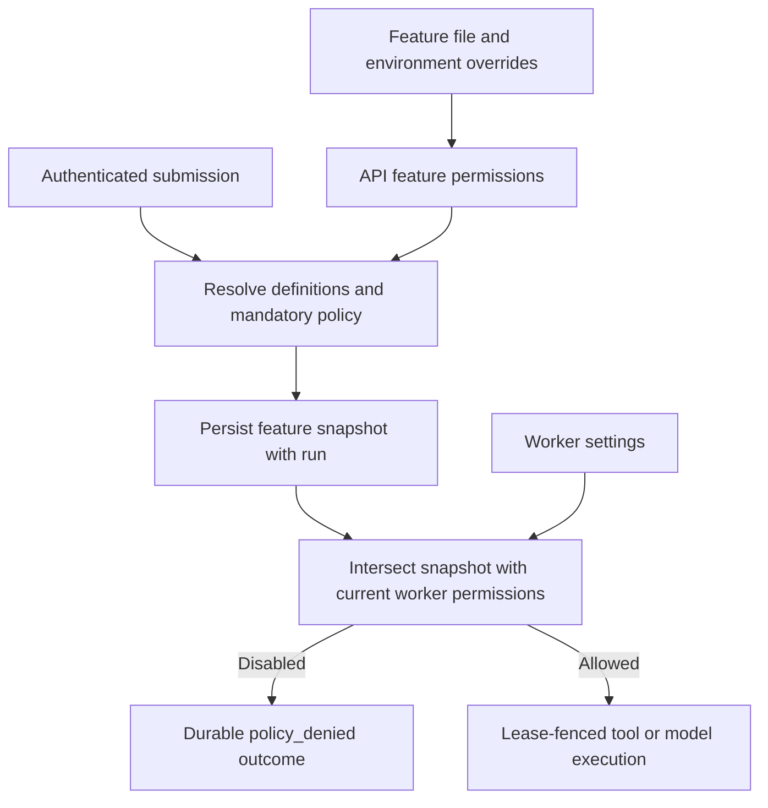

# Agentic System v0.5 architecture

This document describes the current implementation. The acceptance contract is
[SPEC_V05.md](SPEC_V05.md), extending [SPEC_V04.md](SPEC_V04.md), [SPEC_V03.md](SPEC_V03.md) and
[SPEC_V02.md](SPEC_V02.md). The historical v0.3 checks
are in [IMPLEMENTATION_REVIEW_V03.md](IMPLEMENTATION_REVIEW_V03.md); the
[v0.2 review](IMPLEMENTATION_REVIEW.md) remains a historical record.

## Service responsibilities

| Component | Responsibility |
| --- | --- |
| Agent API | Authenticate, authorize, resolve immutable definitions and policy, persist submissions, expose results/events/memory/usage |
| Independent workers | Claim ready steps, renew leases, execute typed tools, checkpoint progress, record bounded outcomes |
| Workflow store | Runs, ordered steps, lease tokens, absolute deadlines, checkpoints, definitions, memory, usage reservations, artifact provenance, events |
| RAGs | Document/index lifecycle, authorized retrieval, source citations; its provider calls have a separate cost boundary |
| Model gateway | Agent planning and synthesis, ordered purpose routes, reservations, usage reconciliation, output allowances |
| Artifact backend | Bounded content-addressed JSON objects in local storage or configured S3 |

The default Compose deployment runs four services: PostgreSQL 17 with pgvector
0.8.7, the Agent API, an independent worker and RAGs. Agent and RAG use separate
databases and non-superuser application roles. RAG owns the native pgvector
knowledge index; Agent memory remains lexical. PostgreSQL has no published host
port, and the two HTTP interfaces bind to localhost. Named application volumes
retain artifacts, caches and legacy SQLite files.

The credential bootstrap creates separate database/admin, requester, approver
and RAG credentials in private files. API and worker receive the same explicit
operational and feature settings. RAG receives its own provider/chunker/tokenizer
configuration and feature file. Optional storage/model adapters still need
their extras and configuration. Custom model-route credential variable names
require an explicit API/worker Compose override.

## Configuration and feature constraints

`Settings` reads operational environment variables once per process.
`AGENT_FEATURES_FILE` supplies a JSON boolean map; `AGENT_FEATURES_JSON`
overrides individual entries. The eighteen-key manifest in `agentic/features.py`
controls optional interfaces, orchestration modes, tools, model generation,
fallback and telemetry. Unknown keys, non-booleans and invalid selected files
fail startup. Permissions do not bypass provider/dependency requirements.

Submission checks the selected mode and tools before committing a run. Execution
checks include automatically planned tools and memory use. Disabling a feature
can block queued or resumed work; later enabling it cannot expand a run's
snapshot. Authentication, tenant/namespace policy, budgets, evidence refusal,
lease fencing and separate approvals are always enforced. Disabled approval
never grants an effect, disabled artifacts create no S3 client, and configured
online generation cannot silently become an offline success.

Authenticated `/capabilities` returns the resolved boolean map, enabled modes
and tools, redacted storage identity and model permissions. The UI and shipped
MCP bridge reflect these capabilities; server-side guards remain authoritative.
MCP also rechecks permissions when invoked. UI/docs routes are absent when
those interfaces are disabled; other disabled operations return an explicit
`403 feature_disabled`. Feature changes require API and worker recreation.

## PostgreSQL transaction architecture

The process shares a bounded pool per DSN/configuration. `AGENT_PG_POOL_SIZE`
(default 4), `AGENT_PG_POOL_TIMEOUT` (5 seconds), and
`AGENT_PG_POOL_MAX_WAITING` (32) bound connection and admission pressure. Size zero
uses direct connections for operational comparison. Forked children cannot reuse
live parent pools; deploy workers with spawn/exec. Pool checkout failures remain
explicit and never select a different storage backend.

Read methods use read-only repeatable-read transactions, so a run plus its steps
come from one snapshot without waiting on the global writer lock. Run mutations
first acquire the shared form of the legacy advisory key, then lock the
tenant-scoped run row before child rows. The shared compatibility lock permits
concurrent new workers but waits for the exclusive lock taken by old workers
and control-plane writers; mixed-version operation remains serialized around
those older writes. Cancellation, refresh, lease renewal,
checkpointing, approval, generated plans, artifact references, and model-budget
reservation/settlement share that order.

PostgreSQL claims find an eligible run with `FOR UPDATE SKIP LOCKED`, then apply
recovery, dependency/approval/deadline decisions and fencing under its row lock.
Workers can skip a busy workflow and claim another. Ready steps in the same run
are still claimed in separate short serialized transitions; tool execution stays
outside the transaction. Queue readiness is computed from current persisted DAG
state, including expired leases. No external broker or Redis queue is added.
SQLite keeps its transactional single-writer claim implementation.

## Submission and definition snapshots

1. API credentials or a verified JWT determine tenant, roles, scopes, and resource
   attributes. The request body cannot select a tenant or a remote endpoint.
2. The control plane resolves an explicit DAG, an immutable workflow definition,
   an offline plan, a durable model-planning step, or a bounded `agent.run` step.
3. Operator policy intersects with the selected policy and agent definition.
   Namespace attributes and permissions narrow access further. Tool, step, round,
   token, and monetary maxima cannot be raised by a submitted definition.
4. The resolved definition and policy are snapshotted with the run. Later
   registrations do not alter active work. Reusing a definition version fails.
   This includes the RAG admission policy and allowed profile IDs; environment
   changes cannot loosen a new-contract run's evidence policy during recovery.
5. Idempotency and queue admission are checked before the new run is committed.
   The same key with different request content fails with `409`.

Model planning happens inside a leased worker step. Its usage is reserved and
recorded against the run, and its validated plan expansion is durable. Explicit
plans support 24 steps; generated subplans support 8. Unknown tools, arguments,
dependencies, and cycles fail validation.

## Durable execution and recovery

A claim records a unique fencing token, lease expiry, attempt count, and an
absolute step deadline. A worker renews its lease while execution is active.
Checkpoint, heartbeat, completion, and failure updates require the current
lease and an active workflow. Cancelled or terminal runs reject late mutations.

Exception retries and expired leases both consume the bounded attempt budget.
The deadline persists across claims, preventing repeated recovery from resetting
the time allowance. The worker applies that remaining deadline to its local
coroutine. Loss of the lease cancels that coroutine when the heartbeat detects
it. Network requests or external effects may already have occurred.

Every owned execution mutation checks the deadline again after acquiring its
database write locks. Late completion, checkpoint, plan expansion, artifact
attachment, retry or heartbeat records a terminal deadline instead of progress.
The worker also checks elapsed time after execution, so a synchronous handler
cannot evade the async timer. Lock waits may delay finalization; they cannot
turn an expired execution into successful durable state. Accounting settlement
remains allowed because expiry cannot erase provider usage already incurred.

Ready DAG steps execute concurrently up to the per-worker bound. Agent-loop
substeps execute sequentially inside one leased `agent.run` step. Its checkpoint
stores the round, plan, cursor, observations, evaluation, and final result.
Recovery resumes committed progress; it does not replay a deterministic event
history. A response received before a crash but not checkpointed may be repeated.
The delivery guarantee remains at least once.

The evidence evaluator validates source identities and applies answer/source
overlap and numeric-support checks. Valid calibrated RAG admission bypasses only
question/source lexical overlap. Refused evidence remains quarantined, including
through nested merges and resumed checkpoints. Acceptance remains a heuristic
outcome rather than a semantic proof. Arithmetic evaluation separately recomputes
the bounded expression. Evidence refusal causes a recorded negative assessment
and bounded refinement. On exhaustion the final result retains the last fixed
refusal reason. Budget, deadline and policy stops remain distinct outcomes.

## Retrieval and synthesis outcomes

The authenticated RAG response carries a validated assessment under the
`rag.search` result's `retrieval` field. An empty retrieval completes its tool
operation so another independent branch can still contribute evidence. It does
not create an extractive answer or usable citations. Refused source identifiers
are quarantined before recursive evidence collection; copying them elsewhere
does not restore trust.

Compatibility normalizes genuine legacy replies as unassessed and honors an
explicit legacy refusal. Malformed typed replies cannot use legacy fallback.
Required mode needs calibrated acceptance, finite score/threshold and a
snapshotted allowed profile ID. Exact structured operations use a separately
validated aggregate and 1..20 dataset identities. Numeric zero is retained;
missing source scope is not treated as a count over an authorized dataset.

Synthesis first collects and validates evidence. With no usable source or exact
observation it returns a typed refusal without a model reservation. Packing uses
complete JSON objects and counts the system/schema instructions, UTF-8 input,
framing and reserved output envelope. A model result must use the finite
`outcome`, `answer`, `cited_ids`, `refusal_reason` JSON contract. Normal model
refusal is not a retryable missing-citation exception; malformed output remains
an execution failure.

A final refusal has outer `outcome=insufficient_evidence`. Store completion
persists that result and marks the step/workflow failed, preventing dependent
publication. REST, authenticated SSE and MCP expose the same durable state.
Events receive only validated enums, bounded counts, approved profile IDs and
reported engine identity, without source bodies or arbitrary upstream trace.

## Authorization and effects

- Requester and approver credentials are disjoint. Verified JWTs check signature,
  algorithm, issuer, audience, expiry, subject, and configured tenant. Roles grant
  named permissions; optional scopes and namespace attributes only narrow them.
  A requester cannot approve their own run with the same JWT subject.
- Each tenant has a distinct configured RAG credential mapped to the same tenant
  in RAGs. The RAG URL is operator-owned. Retrieval requests use `generate:false`;
  returned evidence is bounded and treated as untrusted data.
- Results, events, duplicate submissions, memory, usage inspection, and artifacts
  enforce their relevant tenant and namespace boundaries. Memory provenance must
  refer to an existing authorized tenant run; TTL excludes expired records.
- Typed tools validate arguments again at execution. Adaptive loops may use only
  the registered read-only subset. Retrieved text and model plans cannot grant
  tools, choose arbitrary URLs, or expand budgets.
- `artifact.publish` always requires a separate approval. It stores bounded JSON
  in a content-addressed backend and records the producing run and namespace.
  It does not send email, publish a public post, or initiate a payment.
- Arithmetic uses an allowlisted AST interpreter. This is not a general execution
  sandbox; the tools endpoint reports arbitrary-code execution as unavailable.

The browser UI keeps credentials in page memory and renders returned data as
text. Authenticated SSE rechecks credentials, reads durable event IDs, and accepts
a reconnect cursor. It does not put credentials in a URL. Signed hooks use
operator-bound tenants, HMAC over timestamp and raw body, a five-minute freshness
window, and stored replay receipts before normal workflow validation.

## Model accounting boundary

The gateway routes calls by purpose and ordered operator configuration. It falls
back only for transport failures, `429`, and transient `5xx`. Each attempt first
atomically reserves a conservative UTF-8-byte input estimate plus requested
output allowance. Concurrent reservations share the run budget. The estimate is
not a model-token count.

Valid provider usage replaces the reservation. Missing usage and ambiguous
failures retain explicit estimated charges. Monetary estimates require both
operator-supplied input/output prices; a dollar budget with missing prices is
rejected before the request. Incomplete pricing returns `estimated_cost_usd:null`
and a separate `known_cost_usd` subtotal. Provider usage may differ from the
reservation, and the ledger is not an authoritative billing statement.

The Inkling preset targets `thinkingmachines/Inkling-2-Mini` through Tinker's
OpenAI-compatible sampling endpoint. `reasoning_effort` is validated and explicit;
`max_completion_tokens` caps generation. No `response_format` claim is made:
Tinker documents that it ignores this field, so planner/synthesis schema
validation remains local. Truncated responses fail even if their text happens
to be valid JSON; any valid provider usage is settled first. Separate reasoning
content is never returned as an answer.

`AGENT_MODEL_TIMEOUT_SECONDS` bounds the entire gateway call (90 seconds by
default, configurable from 0.1 to 360), including all fallback attempts and
response-body reads. Slow dribbling does not reset the timer. The worker can
cancel sooner at its persisted deadline, and either cancellation path retains
uncertain reserved charges. Compression is rejected and streamed response bodies
are capped at 1,000,000 bytes before JSON parsing.

The ledger covers agent planning and synthesis. The deterministic evaluator
makes no model call. RAG embeddings, model-assisted retrieval, and any other
external service usage are outside this ledger. A gateway budget is therefore
not a whole-system spending cap.

## Persistence and optional services

| Backend | Implemented behavior | Operational boundary |
| --- | --- | --- |
| PostgreSQL (Compose default) | Bounded process-owned pools; read-only snapshots; shared legacy-lock bridge; tenant/run mutation locks; eligible-run `SKIP LOCKED` claims | Same run transitions serialize; independent workflows and readers can progress concurrently |
| SQLite (explicit development) | WAL, transactions, migration of existing workflow columns | API and workers must share a local file/volume |
| Local artifacts | Tenant-keyed paths, atomic writes, SHA-256 integrity check | Shared artifact storage required across readers/writers |
| S3-compatible artifacts | Configured bucket, bounded requests, tenant-keyed object names, integrity verification | Requires `storage` extra; actual S3-compatible CI service is tested, cloud deployment is separate |
| SQLite rate limiter | Atomic fixed-minute counters shared through a local limiter file | A PostgreSQL workflow DSN does not make the default limiter distributed |
| Redis rate limiter | Atomic shared counter/expiry through Redis | Actual Redis CI service is tested; it is not a task queue |
| OTLP HTTP | Optional safe-attribute traces, operation counts and duration metrics | Requires telemetry extra and a collector; export delivery depends on that collector |

`AGENT_DATABASE_URL` selects the workflow PostgreSQL store. With it unset,
`AGENT_DB_PATH` retains the explicit SQLite development path. Selecting a new
PostgreSQL database does not migrate existing Agent history; no automatic
SQLite-to-PostgreSQL workflow importer is supplied. Preserve and back up the
legacy store or plan a separately reviewed migration. The RAG repository has
its own explicit atomic knowledge-store importer.

Configuration never silently substitutes SQLite for a configured PostgreSQL
store or local files for a configured S3 backend. Adapters validate required
dependencies and settings; Redis and S3 also check connectivity at initialization.
Telemetry fails on missing configuration/dependencies, while collector delivery
is handled by the exporter.

## Observability and deployment limits

Events store structured execution metadata and stopping reasons. Tool failures
persist exception types rather than provider bodies. Telemetry excludes source
text, prompts, credentials, and exception messages from attributes. Protected
run records intentionally retain results, citations, checkpoints, and memory;
they require retention policy, database access controls, and backups.

The implementation does not provide a managed secret vault, tamper-evident audit
chain, external task queue, worker autoscaler, deterministic history replay,
general code sandbox, or semantic memory index. PostgreSQL transactions are
serialized per workflow for correctness; admission and schema control still use
a short global advisory lock. Fairness, saturation behavior, failover, and
multi-host operations require deployment-specific validation. TLS, identity
provider administration, secrets provisioning, and backup recovery remain
operator responsibilities.
